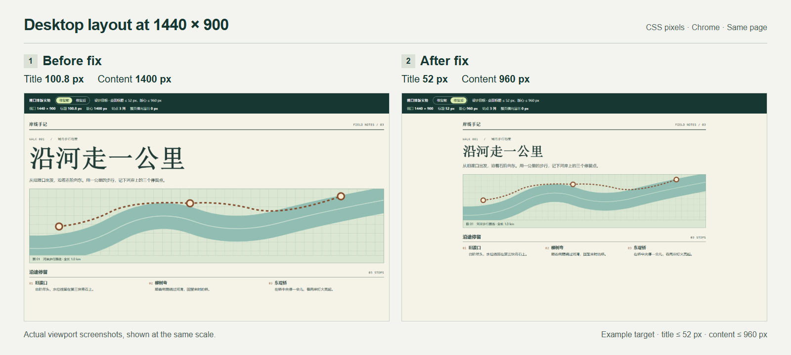
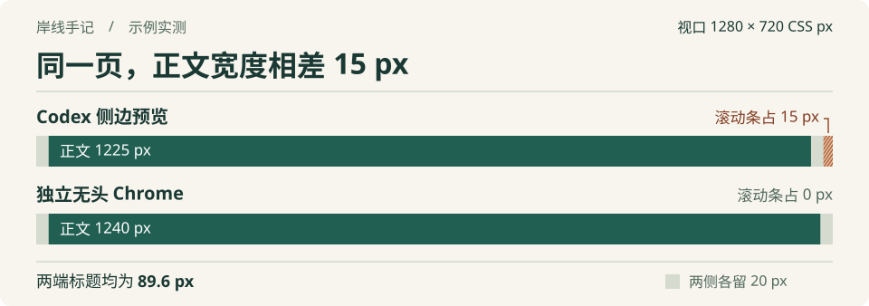

# web-preview-scaling

[简体中文](README.md) | **English**

[](https://github.com/jinyangtang33-sys/web-preview-scaling/actions/workflows/layout-regression.yml)

**Experimental.** Seven synthetic task scenarios and two no-skill controls have been evaluated; real-project acceptance is still pending. CI covers the measurement script, example layout and output checker. [Test scope and release criteria (Chinese)](evals/README.md) · [Evaluation record (Chinese)](evals/results/2026-11-04/README.md)

Does your page look right in Codex's side preview, but feel oversized or too wide in a standalone browser? This skill guides Codex to measure the same elements at matching CSS viewport sizes, then widen the viewport to identify differences caused by scrollbars, font-size rules, or responsive breakpoints.



Both panels are actual first-viewport captures of the example in standalone headless Chrome, at **1440 × 900 CSS px**, displayed at the same scale. On the left, the `7vw` title grows to **100.8 px** and the content spans **1400 px**. On the right, upper limits bring the title to **52 px** and the content width to **960 px**. These limits are the example's design targets. Use your project's own design specifications when applying the skill.

The fix consists of two CSS rules. Switch between **修复前 (Before)** and **修复后 (After)** at the top of the example to reproduce it.

```css
main { max-width: 960px; }
h1 { font-size: clamp(30px, 7vw, 52px); }
```

## Get started in Codex

Send this installation request to Codex.

```text
$skill-installer Install the skill from the main branch of https://github.com/jinyangtang33-sys/web-preview-scaling. SKILL.md is at the repository root (--path .). Use web-preview-scaling as the installation name (--name web-preview-scaling).
```

After installation, start your project's development server and open the page you want to check. Replace the URL below with your own, then send this request to Codex.

```text
$web-preview-scaling Check http://localhost:3000/ . The title looks right in the side preview but too large in a standalone browser. First compare at the preview's actual viewport size, then check 1440 × 900. Report the title's font size, the content width, and the CSS rules responsible for any differences.
```

Codex can inspect the page with its existing browser tools. For measurements across multiple viewports or saved screenshots, run the bundled script from a project that has Playwright installed. [Script instructions (Chinese)](SKILL.md#采集可复查的读数) · [OpenAI skill guide](https://learn.chatgpt.com/docs/build-skills)

## Try the example

The example is a riverside walking-route page. Download and extract the repository ZIP, then open `example/index.html` in your browser. The strip at the top shows the CSS viewport size, title font size, content width, and column count in real time. [Download ZIP](https://github.com/jinyangtang33-sys/web-preview-scaling/archive/refs/heads/main.zip)

1. Set the browser's responsive viewport to **1440 × 900** and switch from **修复前 (Before)** to **修复后 (After)**. The title shrinks from **100.8 px** to **52 px**, and the content width is capped at **960 px**. The font-size change comes from the new limit in `clamp(30px, 7vw, 52px)`.

2. Change the viewport width from **759 px** to **760 px**. The section labeled **沿途停留 (Stops along the way)** changes from one column to three. Both the Before and After versions should switch at the same width.

On pushes to `main` and pull requests targeting `main`, GitHub Actions uses Chrome to check the title font sizes and column counts around the breakpoint in both versions. [Example source](example/index.html) · [Regression tests](tests/layout.test.cjs) · [CI runs](https://github.com/jinyangtang33-sys/web-preview-scaling/actions/workflows/layout-regression.yml)

<details>
<summary>Another case · How can a scrollbar change content width at the same viewport size?</summary>



This is another measurement of the example before the fix. The top bar is Codex's side preview, with a **1225 px** content area and a **15 px** scrollbar. The bottom bar is standalone headless Chrome, with a **1240 px** content area and no width reserved for a scrollbar. Both leave 20 px on each side of the content. Both titles use `7vw`, which resolves to **89.6 px** at this viewport size. This width difference alone calls for no font-size change. Compare `window.innerWidth` with `document.documentElement.clientWidth` to measure the scrollbar space in your own environment.

</details>
