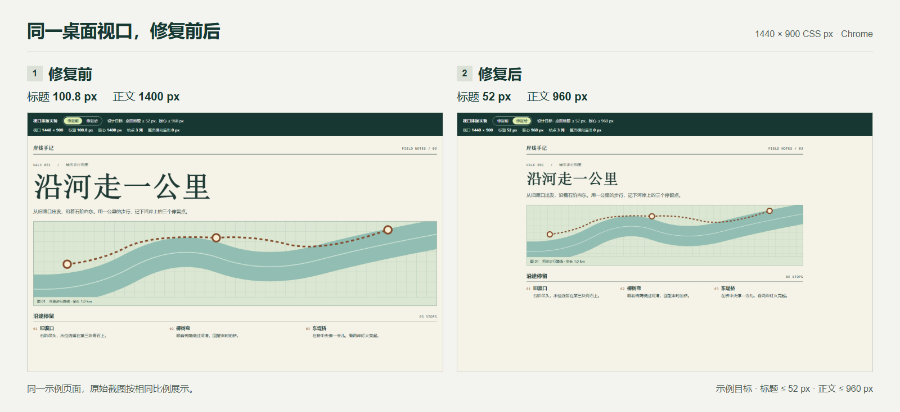
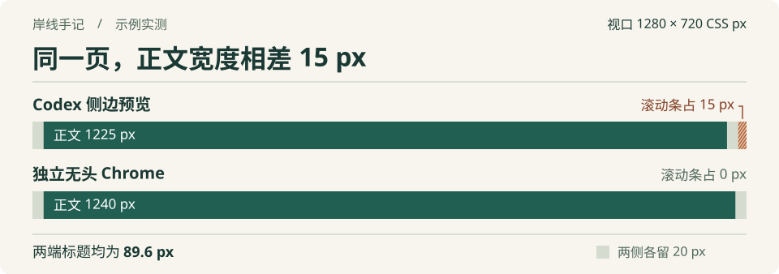

# web-preview-scaling

**简体中文** | [English](README.en.md)

[](https://github.com/jinyangtang33-sys/web-preview-scaling/actions/workflows/layout-regression.yml)

**当前为实验版。** 第六轮中，有 skill 的手机素材首页首屏能看全 4 个条目名称，固定无 skill 对照为 0 个；但预约页盲评分歧，且素材页在换尺寸返回后出现筛选不可用的退化。整体门槛未通过。基础 CI、行为回归与真实页面结果分开报告。[真实网页效果对照](evals/results/2026-11-04-visual-outcomes/README.md) · [测试范围与发布标准](evals/README.md) · [触屏漏检复测](evals/results/2026-11-04-touch-rerun/README.md)

这个 skill 帮助 Codex 按网页的实际任务调整信息层级、内容尺寸和响应式布局：列表便于扫读，详情看清主体，表单便于填写和修错。它要求查看同状态的前后渲染并复测操作，也保留相同 CSS 视口下的预览差异排查。

下面是字号与版心约束的基础示例，展示测量方法；它本身不是有 skill / 无 skill 的效果证据。



两张图都来自示例页在独立无头 Chrome 中的真实首屏截图，CSS 视口均为 **1440 × 900**，按相同比例展示。左侧的 `7vw` 标题长到 **100.8 px**，正文铺到 **1400 px**；右侧为标题和正文加上上限，分别收至 **52 px** 和 **960 px**。这两个上限是示例的设计目标，实际项目应沿用自己的设计规范。

对应的修复只有两条 CSS 规则，可以在示例顶部切换「修复前 / 修复后」复现。

```css
main { max-width: 960px; }
h1 { font-size: clamp(30px, 7vw, 52px); }
```

## 在 Codex 里开始用

把下面的安装请求发给 Codex。

```text
$skill-installer 请从 https://github.com/jinyangtang33-sys/web-preview-scaling 的 main 分支安装 skill。SKILL.md 在仓库根目录（--path .），安装名为 web-preview-scaling（--name web-preview-scaling）。
```

安装后，在你的网页项目中启动开发服务器，打开要检查的页面。把下面的网址换成自己的，再发给 Codex。

```text
$web-preview-scaling 请检查 http://localhost:3000/ 。侧边预览里标题大小合适，浏览器打开后显得太大。先按预览的实际视口对照，再看 1440 × 900。告诉我标题字号、正文宽度和造成差异的 CSS 规则。
```

需要完善整个页面时，可以这样提出任务：

```text
$web-preview-scaling 请完善 http://localhost:3000/ 的桌面和手机效果。沿用现有品牌、内容和功能，让主要信息更容易辨认，操作更清楚。实际查看修改前后页面，验证关键流程，并给出同状态的效果证据和取舍。
```

[呈现质量判断](references/render-quality.md) 区分列表、详情和表单的任务，[布局与状态模式](references/layout-patterns.md) 提供字段并排、卡片操作与错误对齐的具体规则。复杂页面优化在工具允许时比较两份独立实现，再选择、修正和复查；这会增加执行时间与模型调用，不用于宣称更省成本。单一文案和明确故障保持原任务范围。[尺寸与预览诊断](references/preview-diagnostics.md) 按需读取；`render-inspect.cjs` 辅助记录图片拟合尺寸、内容可见性候选和操作位置，读数不自动判定页面优劣。

Codex 可以用已有浏览器工具读取页面。若要批量采样或保存截图，可在装有 Playwright 的项目中使用仓库附带的脚本。[测量脚本用法](SKILL.md#采集可复查的读数) · [OpenAI 的 skill 使用说明](https://learn.chatgpt.com/docs/build-skills)

## 用示例验证

示例是一张河岸步行路线页。下载仓库 ZIP，解压后用浏览器打开 `example/index.html`。页面顶部会实时显示 CSS 视口、标题字号、正文宽度和列数。[下载仓库 ZIP](https://github.com/jinyangtang33-sys/web-preview-scaling/archive/refs/heads/main.zip)

1. 将浏览器的响应式视口设为 **1440 × 900**，切换「修复前 / 修复后」。标题会从 **100.8 px** 降到 **52 px**，正文宽度会收至 **960 px**。这次字号差来自标题新增的上限 `clamp(30px, 7vw, 52px)`。

2. 将视口宽度从 **759 px** 调到 **760 px**。「沿途停留」会从一列变为三列。切换修复前后，两种样式都应在同一个宽度换列。

推送到 `main` 或向 `main` 提交 PR 时，GitHub Actions 会用 Chrome 核对两个版本的标题字号和断点列数。[示例源码](example/index.html) · [回归测试](tests/layout.test.cjs) · [CI 运行记录](https://github.com/jinyangtang33-sys/web-preview-scaling/actions/workflows/layout-regression.yml)

<details>
<summary>补充案例 · 同一视口下，滚动条为什么会影响正文宽度？</summary>



这是示例页「修复前」的另一次实测。正文两侧各留 20 px，预览滚动条又占了 15 px，因此正文恰好窄了 15 px。标题在两处都是 `7vw`，同一视口下算出来都是 89.6 px。仅凭这次宽度差，无需调整字号。比较 `window.innerWidth` 和 `document.documentElement.clientWidth`，可以查看自己环境中的滚动条占宽。

</details>
