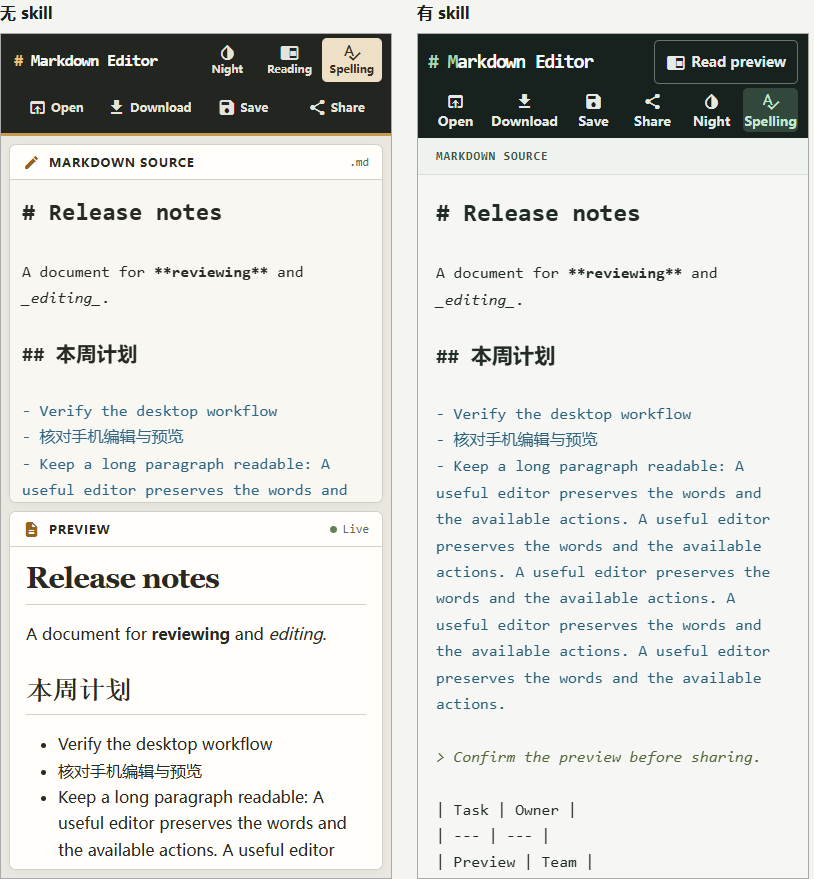

# 精简候选在新 Markdown 编辑器上的等预算验证

**未通过明确优势门槛。** 两位新盲评都小幅偏好有 skill，19/17、18/17，平均 +1.5/24，低于冻结的 +2 门槛。两版各48项主功能检查通过，无新增退化。本次不再修改、重评或反复调到通过。

## 为什么修改

TodoMVC 的两版均通过功能验收，常规可读性和输入操作的改善没有形成组间差异；偏好主要来自控制位置、持续标签和关键后果说明。原 skill 的通用布局建议重复较多，默认多代理流程又无法在三次回复限制下执行。旧评测还将全部参考一次性装入。详见[分析与修订依据](../../skill-revision-2026-11-05.md)。

四份设计文档由8505字符减至2264字符（按LF统计，约减少73.4%）；保留任务路径、决策后果、跨状态与跨尺寸边界，删掉默认双完整方案与固定列数模板。测量脚本及预览诊断未修改。精简冻结为 [78c5386](https://github.com/jinyangtang33-sys/web-preview-scaling/commit/78c53863050ac71050916c2cf637b2a117e1289d)，随后才读取新项目运行代码。没有再修改 TodoMVC。

本轮按页面优化路由仅载入 SKILL.md 与 render-quality.md，共1556字符。条件参考没有无差别装入。这里同时改变指导内容与载入方式，不能把结果单独归因于长度；更没有在同一项目上比较旧、新候选，不能声称精简提高或降低了质量。

## 新项目与预算

使用 [jbt/markdown-editor](https://github.com/jbt/markdown-editor/tree/58aa8bfe18c5a30af2c6fb08221b00b841688dd9)，提交 `58aa8bf`。这个编辑器没有参与此前 skill 开发。源代码完整复制，没有植入故障；只有 index.html、index.css、index.js 可以改，其他依赖逐文件核对不变。第三方库及其许可在 runtime.zip 内保留，项目许可见 [SOURCE-LICENSE](SOURCE-LICENSE)。

任务是改善写作、实时预览和审阅的关系，保留导入、下载、浏览器保存、分享链接、阅读、夜间、拼写开关及原有快捷键。每轮收到自己的同状态截图与相同类型的采集反馈，不提供旧案例方案或分数。

| 条件/结果 | 无 skill | 有 skill |
| --- | --- | --- |
| 模型 / 推理 | gpt-6-astra / xhigh | gpt-6-astra / xhigh |
| 代码回复 / 模型工具调用 | 3 / 0 | 3 / 0 |
| 总上限 / 每次回复上限 | 900 / 300秒 | 900 / 300秒 |
| 实际耗时（含应用与采集） | 406.90秒 | 490.19秒 |
| input tokens（原事件值） | 114801 | 117378 |
| output tokens（原事件值） | 14158 | 17477 |
| 功能主检查 | 48项通过 | 48项通过 |
| 评审1 | 17/24 | 19/24 |
| 评审2 | 17/24 | 18/24 |

预算审计见 [budget-audit.json](budget-audit.json)，全部输入指纹与载入清单见 [protocol.json](protocol.json)。三次回复均为可精确应用的文本补丁，由程序原子应用，无维护者改稿。服务内部重试不可观测；相同时间上限和回复次数不意味着相同token、缓存、费用或实际耗时。本轮无需重启或更换交付格式。

## 看到的差异与取舍

无 skill 版手机采用上下分区，输入时能同时看到部分实时预览；有 skill 版将手机写作区展开，通过明确的 Read preview / 返回编辑入口切换。评审小幅偏好后者的长文空间和模式含义；它也增加了来回对照的切换成本。桌面两版均有清楚的源码与预览分区、文字动作和可读内容。

[全部状态对照](comparison.html)可离线查看；每位评审实际查看20张原尺寸图（两版、两种尺寸、五状态），标签交换，只获原任务与匿名画面，不接触源码、skill、分组、用量或另一评审。[评审1](judge-1.md)、[评审2](judge-2.md)、[汇总判定](summary.json)均保留原结论。

独立[功能复核](functional-results.json)覆盖真实入口、文字输入、预览、导入、下载内容、浏览器保存/覆盖/刷新、分享恢复、原快捷键与模式切换。两版各48项主检查通过，12项补充检查无失败，其中不适用项如实保留。HTML导出与原版逐字相同。补充检查数量不作为视觉增益证据。

原版没有移动 viewport meta：外部390×844下实际为980 CSS宽，且手机写作态下载菜单被覆盖。原版有效45/48通过，这些局限单列；两最终产物实际为390×844、hover:none/coarse，无根横溢。源截图中的“390”表示请求的外部视口，不冒充390 CSS布局。

词典依赖外部CDN，本次统一阻断外网，故实际拼写纠错未验证，只核验开关原契约；公式在线渲染、实体手机/软键盘、辅助技术及其他浏览器亦未验证。有限Chrome测试不证明所有功能场景正确。

## 复查与边界

运行 `python verify-proposals.py` 可重放两边三次补丁、核对最终文本及全部未改依赖。Windows原始SHA与统一LF指纹分开保存。运行 `python serve.py 8000`，打开 `http://127.0.0.1:8000/comparison.html`；访问 `/without/` 或 `/with/` 可实际操作。服务会从共享 runtime.zip 读取原始依赖，不重复放三套库。

主功能脚本见 [functional.cjs](functional.cjs)，公开副本仅适配模块解析、Chrome路径和URL参数。安装 `playwright-core@1.62.1` 并准备Chrome后，可执行 `node functional.cjs http://127.0.0.1:8000/without/ verify-without`，另一组将URL改为 `/with/`；结果写入指定标签目录。外部词典请求仍统一阻断。

这是一次新项目有效配对，只有两位模型评审，没有随机种子重复或真人偏好数据。两次未见项目都出现小幅正向偏好，但它们是不同项目、不同候选和不同载入方式，不能合并当作统一版本的重复实验或统计显著性证据。当前不足以宣称稳定、足够大的独立价值。
