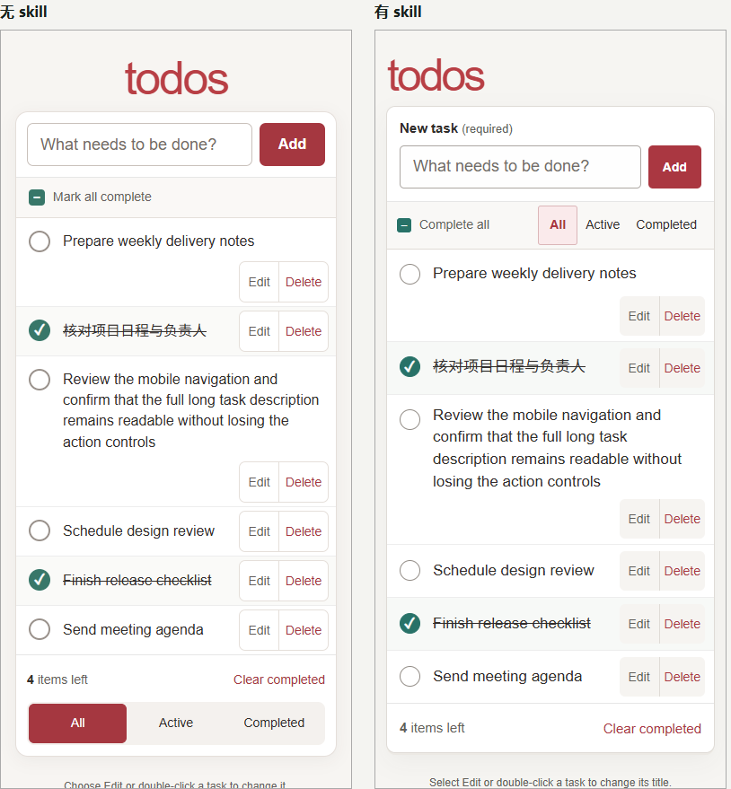

# 新项目、相同回复次数与时间上限

**本轮未达到预设的明确优势门槛。** 两位匿名评审都小幅偏好有 skill，比分为 20/18 和 19/18，平均 +1.5/24；门槛事先设为 +2，保持不变。两份交付均通过功能复核。这个新项目提供了弱正向证据，尚不能据此证明 skill 有稳定或足够大的独立收益。

## 冻结输入与资源

新项目为 [TodoMVC 原生 JavaScript 应用](https://github.com/tastejs/todomvc/tree/ff43b02e59dfa604386bb382034b2cd07c2bcd8a/examples/javascript-es5/dist)，提交 `ff43b02`。它没有参与本 skill 的开发反馈；这是公开参考应用，并非生产业务系统。使用未经植入缺陷的原始构建产物，完整来源及许可见 [SOURCE-LICENSE.md](SOURCE-LICENSE.md)。

被测 skill 固定为 [059335f](https://github.com/jinyangtang33-sys/web-preview-scaling/commit/059335f9667d9777ca5d6e0cd67477f4d96100de)，本次没有修改 skill，也不依据本次评分调优这个项目。两边收到相同任务、原始源码、合成任务数据，以及桌面 1440×900、触屏模拟 390×844 下相同类型的截图。请求改善日常任务辨认与操作，保留新增、编辑/取消、完成、筛选、删除、清除完成项和署名。原版仅使用内存存储，刷新清空属于原有语义。

| 资源/结果 | 无 skill | 有 skill |
| --- | --- | --- |
| 执行模型与推理设置 | gpt-6-astra / xhigh | gpt-6-astra / xhigh |
| 可审计代码回复 | 3 | 3 |
| 模型工具调用 | 0 | 0 |
| 总时间上限 | 900 秒 | 900 秒 |
| 实际耗时，含应用和采集 | 458.52 秒 | 502.26 秒 |
| input tokens（事件原值） | 129631 | 151574 |
| output tokens（事件原值） | 16643 | 18484 |
| 同一功能脚本 | 30/30 | 30/30 |
| 补充操作复核 | 8/8 | 8/8 |
| 评审 1 | 18/24 | 20/24 |
| 评审 2 | 18/24 | 19/24 |

按用户认可的口径计数：每个执行者交付三次代码回复，统一脚本精确应用补丁，回传自己的同状态截图和测试反馈。两边均不能调用工具、增加模型评审或委派；因此这里测的是受限流程中加入冻结 skill 文字的效果，不能外推为其完整多代理流程。全部模型回复与用量来自执行事件；服务内部重试不可观测。时间上限和回复次数相同，实际耗时、token、缓存命中和费用不宣称相同。

## 实际观察

评审依据是有 skill 版的筛选位于任务列表之前、新增字段保持可见标签、编辑时提示空标题将删除任务。无 skill 版也有明确的新增、编辑、删除与保存/取消入口，长文完整换行。两版都修复了原版的三类键盘入口限制；功能改善本身没有形成组间优势。



对照同状态的[无 skill 页面](without/screenshots/390-mixed.png)，以及[全部状态的交互式对照](comparison.html)。这是浏览器实拍；每位评审实际查看 16 张原尺寸截图，标签交换，不接收分组、skill、模型方案或对方评分。功能复核由另一位未参与制作的执行者用同一脚本完成。

## 失败执行和结论边界

首次执行因忽略本机连接配置，两边都未返回代码；相同的空 JSON/图片诊断请求，在加载配置后约 13 秒完成，忽略配置超过 55 秒。恢复共同配置后的整文件交付格式，一边首轮超时，另一边返回一份约 1.1 万输出 token 的方案；因回复次数已不等而停止，未打网页质量分。两次无效尝试保存在本机，不充当有 skill 获胜的证据。

首次有效配对改用共同的精简文本补丁格式，从相同原始副本和新的独立会话开始，不提供前次方案。skill、任务、模型、推理设置、三次回复及时间上限均未变。只有这次配对满足资源审计；没有因为分数不足继续生成或重打分。协议和上述尝试见 [protocol.json](protocol.json)，用量及文件指纹见 [budget-audit.json](budget-audit.json)，判定见 [summary.json](summary.json)、[评审 1](judge-1.md)、[评审 2](judge-2.md)和[独立功能复核](functional-results.json)。

这只是一个新参考项目、一次有效配对、两个模型评审。未检验不同模型、项目类型、随机种子或重复执行；没有真人偏好、真机、屏幕阅读器或其他浏览器验证。模型别名的后端权重版本未提供。小幅偏好不是统计显著性，也不足以推翻预设门槛未通过的结论。

## 本机复查

原始代码在 [source](source/index.html)，最终两份代码在 [without](without/index.html) 与 [with](with/index.html)。三次补丁分别保存为 `without-proposal-1..3.json`、`with-proposal-1..3.json`，可以按序核对原始源码到最终源码；补丁只替换唯一匹配文本，无维护者手动改稿。

运行 `python verify-proposals.py` 可以不调用模型地重建并核对全部最终文件。审计保留 Windows 原始字节 SHA-256，并另外提供统一 LF 换行的指纹，避免 Git 换行转换导致假失效。

在本目录运行 `python -m http.server 8000 --bind 127.0.0.1`，打开 `http://127.0.0.1:8000/comparison.html` 查看截图，或访问 `/without/`、`/with/` 实际操作。复测需要 Chrome 与 `playwright-core@1.62.1`：

```sh
npm install --no-save --no-package-lock --ignore-scripts playwright-core@1.62.1
node functional.cjs --url http://127.0.0.1:8000/without/ --label verify-without
node functional.cjs --url http://127.0.0.1:8000/with/ --label verify-with
```

脚本会输出逐项 JSON 和截图；历史实测结果保存在两份源码旁。基础 CI 不会调用模型或自动复跑这项等预算实验。
